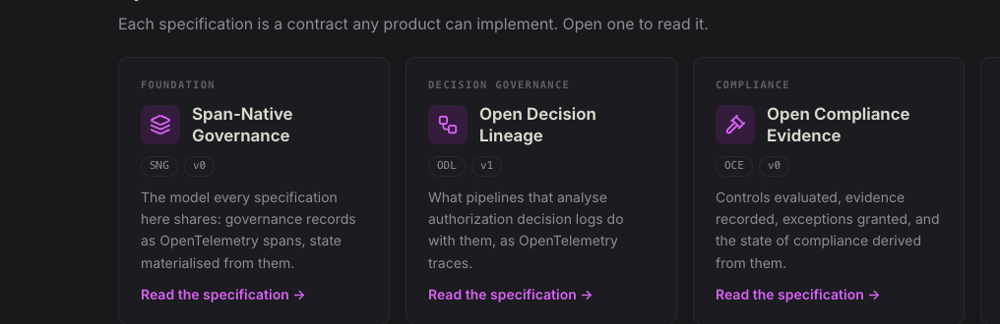

# Attributes

Every OCE attribute is in the `oce.` namespace, with dot-separated segments in `snake_case`.
OCE reuses OpenTelemetry's attributes where one exists for the same concept.

<Diagram of="oce/attributes" />

## Requirement levels

The requirement levels follow the [OpenTelemetry definitions](https://opentelemetry.io/docs/specs/semconv/general/attribute-requirement-level/).

| Level       | Meaning                                                                       |
| ----------- | ----------------------------------------------------------------------------- |
| Required    | the attribute MUST be set on every span the convention applies to             |
| Recommended | the attribute SHOULD be set when the information is available to the producer |
| Optional    | the attribute MAY be set                                                      |
| Not used    | the attribute SHOULD NOT be set on spans of this kind                         |

## Resource attributes

Recorded on the OpenTelemetry resource of the producer, not on its spans.
They name the organisation whose obligations the spans are about.

| Attribute               | Type   | Level       | Meaning                                                                        |
| ----------------------- | ------ | ----------- | ------------------------------------------------------------------------------ |
| `oce.version`           | String | Required    | `"0.1"`: the version of this specification the spans follow; it makes them OCE |
| `oce.organization.id`   | String | Required    | the organisation the obligations fall on, stable: `northwind-hr`               |
| `oce.organization.name` | String | Recommended | the name a person reads: `Northwind HR`; the id when absent                    |
| `service.name`          | String | Recommended | OpenTelemetry's own: the system that emitted the spans                         |

## Span attributes

| Attribute               | Type   | Meaning                                                                                                            |
| ----------------------- | ------ | ------------------------------------------------------------------------------------------------------------------ |
| `oce.span.kind`         | String | `trigger`, `obligation`, `action` or `close`                                                                       |
| `oce.case.id`           | String | the case, a UUIDv7                                                                                                 |
| `oce.trigger.type`      | String | what happened: `serious_incident`, `personal_data_breach`, … ([Cases](./cases#what-opens-a-case))                  |
| `oce.subject.id`        | String | what the case is about: `cv-screening`                                                                             |
| `oce.subject.type`      | String | `ai_system`, `product`, `service`, `processing`, `ict_service`, or another                                         |
| `oce.subject.name`      | String | the name a person reads; the id when absent                                                                        |
| `oce.obligation.id`     | String | the obligation, unique within its case: `ai-act-73-2`                                                              |
| `oce.obligation.name`   | String | what it asks, as a person reads it: `Report the serious incident`                                                  |
| `oce.obligation.action` | String | the kind of action that meets it: one of the six of `oce.action.kind`                                              |
| `oce.obligation.due`    | String | when it must be met, an RFC 3339 time; none when the law sets no deadline                                          |
| `oce.obligation.quorum` | Int    | how many distinct actors must perform the action; 1 when absent                                                    |
| `oce.law.id`            | String | the law: `eu-ai-act`, `eu-gdpr`, … ([Legal References](./laws))                                                    |
| `oce.law.article`       | String | the article: `73`                                                                                                  |
| `oce.law.paragraph`     | String | the paragraph: `2`                                                                                                 |
| `oce.law.point`         | String | the point, nested points joined by `.`: `a`, `49.b`, `d.i`                                                         |
| `oce.law.version`       | String | the consolidated text the obligation was read from, by its date: `2026-07-27`                                      |
| `oce.law.celex`         | String | the law's CELEX number, for the EU's own: `32024R1689`                                                             |
| `oce.party.role`        | String | the role the law gives the organisation: `provider`, `deployer`, `controller`, …                                   |
| `oce.action.kind`       | String | `assess`, `review`, `notify`, `inform`, `remediate` or `record`                                                    |
| `oce.action.result`     | String | `applies` or `not_applicable` for an assessment; `confirmed`, `overridden`, `rejected` or `escalated` for a review |
| `oce.action.recipient`  | String | to whom: `market_surveillance_authority`, `csirt`, `provider`, `data_subject`, …                                   |
| `oce.action.reference`  | String | the reference the recipient gave: the number of a submitted report                                                 |
| `oce.actor.id`          | String | who acted: a pseudonymous id the organisation can resolve, never a name                                            |
| `oce.actor.role`        | String | in which role: `oversight_officer`, `dpo`, `ciso`, …                                                               |
| `oce.evidence.ref`      | String | a URI of what proves the action: the report, the log, the decision of the review                                   |
| `oce.evidence.digest`   | String | its digest, `sha256:` and lower-case hexadecimal                                                                   |
| `oce.case.state`        | String | `closed` or `withdrawn`                                                                                            |

### Levels by span kind

The level of each attribute on each kind of span: **R** Required, **Rc** Recommended, **O** Optional, **–** Not used.

| Attribute               | trigger | obligation | action | close |
| ----------------------- | :-----: | :--------: | :----: | :---: |
| `oce.span.kind`         | R       | R          | R      | R     |
| `oce.case.id`           | R       | R          | R      | R     |
| `oce.trigger.type`      | R       | –          | –      | –     |
| `oce.subject.id`        | R       | –          | –      | –     |
| `oce.subject.type`      | Rc      | –          | –      | –     |
| `oce.subject.name`      | O       | –          | –      | –     |
| `oce.obligation.id`     | –       | R          | Rc     | –     |
| `oce.obligation.name`   | –       | Rc         | –      | –     |
| `oce.obligation.action` | –       | R          | –      | –     |
| `oce.obligation.due`    | –       | Rc         | –      | –     |
| `oce.obligation.quorum` | –       | O          | –      | –     |
| `oce.law.id`            | –       | R          | –      | –     |
| `oce.law.article`       | –       | R          | –      | –     |
| `oce.law.paragraph`     | –       | Rc         | –      | –     |
| `oce.law.point`         | –       | O          | –      | –     |
| `oce.law.version`       | –       | Rc         | –      | –     |
| `oce.law.celex`         | –       | O          | –      | –     |
| `oce.party.role`        | –       | Rc         | –      | –     |
| `oce.action.kind`       | –       | –          | R      | –     |
| `oce.action.result`     | –       | –          | Rc     | –     |
| `oce.action.recipient`  | –       | –          | Rc     | –     |
| `oce.action.reference`  | –       | –          | O      | –     |
| `oce.actor.id`          | –       | O          | Rc     | O     |
| `oce.actor.role`        | –       | O          | O      | O     |
| `oce.evidence.ref`      | O       | O          | Rc     | O     |
| `oce.evidence.digest`   | O       | O          | Rc     | O     |
| `oce.case.state`        | –       | –          | –      | R     |

Levels marked Recommended on an action apply where they make sense: `oce.action.result` and `oce.actor.id` are Required on a `review`, and `oce.action.result` on an `assess`; `oce.action.recipient` on a `notify` or an `inform`.
`oce.actor.id` on an obligation or a close says who assessed or closed.

## Value rules

| Rule    | Meaning                                                                                                                             |
| ------- | ----------------------------------------------------------------------------------------------------------------------------------- |
| Types   | the OTLP primitive of the same name; a quorum MUST NOT be sent as a string                                                          |
| Times   | `oce.obligation.due` is an RFC 3339 time with its offset: `2026-12-29T09:30:00Z`                                                    |
| Words   | `oce.trigger.type`, `oce.subject.type`, `oce.party.role`, `oce.action.recipient` and `oce.actor.role` are `snake_case`              |
| Enums   | `oce.span.kind`, `oce.action.kind`, `oce.obligation.action`, `oce.action.result` and `oce.case.state` take only the values listed   |
| Empty   | an empty string is the same as an absent attribute                                                                                  |
| Persons | an actor, an affected person or a data subject is never named: `oce.actor.id` is pseudonymous, and nothing else identifies them     |
| Content | a report, a complaint, a decision or a log is named by `oce.evidence.ref` and `oce.evidence.digest`, never copied into an attribute |

The last two rules matter more here than anywhere: the events that engage the law are often the ones that harmed someone.
OCE spans travel to systems that do not apply the access rules of the case; they say that a person was informed, never who.
